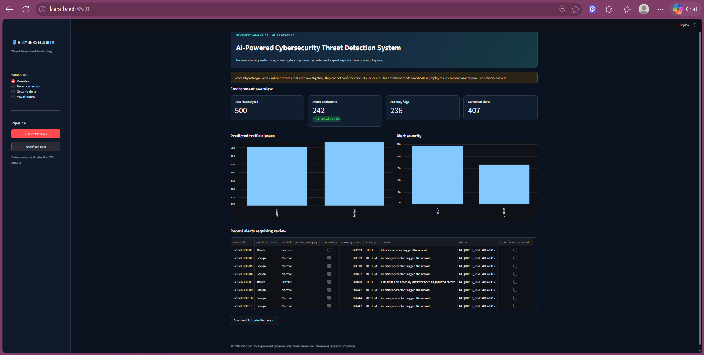

# AI-Powered Cybersecurity Threat Detection System

An AI-powered cybersecurity prototype that analyzes network traffic records, identifies potential attacks, flags anomalous activity, and generates security alerts through an interactive Streamlit dashboard.

## Dashboard Preview



> The dashboard displays results from dataset-based detection and simulation. It is a defensive research prototype, not a live network monitoring system.

## Features

- **AI-assisted detection:** Uses machine-learning predictions to classify network traffic records.
- **Anomaly detection:** Flags records with unusual patterns.
- **Security alerts:** Generates alerts from analyzed records.
- **Interactive dashboard:** View detection metrics, records, alerts, and visual reports.
- **Data filtering:** Explore records and alerts using available filters.
- **CSV exports:** Download detection results and alert data for further analysis.
- **Visual analytics:** View generated charts and detection summaries.

## Technology Stack

- Python
- Pandas
- Scikit-learn
- Streamlit
- Matplotlib
- UNSW-NB15 network intrusion detection dataset

## Project Structure

```text
Ai-cybersecurity-threat-detection/
├── dashboard/
│   └── app.py
├── data/
│   └── raw/
├── outputs/
│   ├── alerts/
│   ├── figures/
│   └── reports/
├── screenshots/
│   └── dashboard-overview.png
├── src/
├── .gitignore
├── README.md
└── requirements.txt
```

*The structure above is a simplified overview; the exact files may vary by project version.*

## Detection Results

In one recorded dataset replay, the system processed 500 records.

| Metric | Recorded result |
|---|---:|
| Records analyzed | 500 |
| Attack predictions | 242 |
| Anomaly flags | 236 |
| Alerts generated | 407 |

These are outputs from a particular run, not verified real-world attacks. Attack predictions, anomaly flags, and generated alerts may overlap. They should not be interpreted as model accuracy or as 407 confirmed security incidents.

## Installation and Setup

### 1. Clone the repository

```powershell
git clone https://github.com/ParthPatil00/Ai-cybersecurity-threat-detection.git
cd Ai-cybersecurity-threat-detection
```

If your project uses a nested inner folder, enter the directory containing `dashboard`, `src`, and `requirements.txt`.

### 2. Create and activate a virtual environment

```powershell
py -3.11 -m venv .venv
.\.venv\Scripts\Activate.ps1
```

If PowerShell blocks activation, consult the Python virtual-environment documentation or activate the environment using your preferred terminal.

### 3. Install dependencies

```powershell
python -m pip install -r requirements.txt
```

### 4. Run the dashboard

From the project root, run:

```powershell
streamlit run dashboard/app.py
```

Streamlit will provide a local URL to open in your browser.

## Output Files

Depending on the detection run, the project can generate:

- `outputs/reports/detection_results.csv` — analyzed records and detection results
- `outputs/alerts/security_alerts.csv` — generated security alerts
- `outputs/figures/attack_distribution.png` — an attack-distribution visualization

## Dataset and Responsible Use

This project uses the UNSW-NB15 network intrusion detection dataset for defensive experimentation and analysis. Results depend on the dataset, preprocessing, model configuration, and detection thresholds.

The current prototype does not establish that a live system is compromised, and it does not replace a production security monitoring platform. Validate model performance with appropriate evaluation metrics and testing before using results to make security decisions.

## Future Improvements

- Live network telemetry integration
- Model evaluation using precision, recall, F1-score, and a confusion matrix
- Configurable alert severity and thresholds
- More detailed detection history and trend analysis
- Automated testing and deployment

## Author

**Parth Patil**

GitHub: [ParthPatil00](https://github.com/ParthPatil00)
